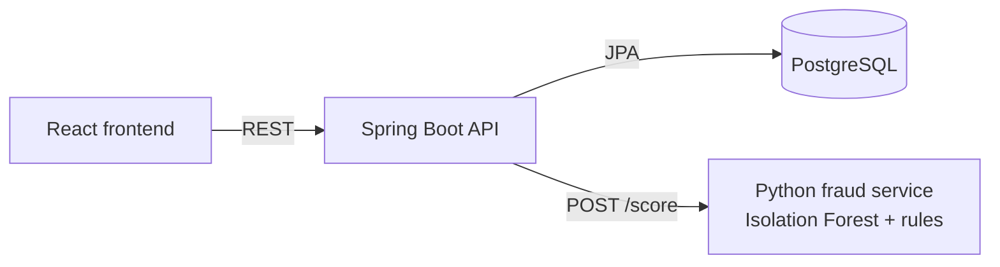

# MiniBank 🏦

A full-stack banking app with **AI fraud detection**. Customers can open accounts, deposit, withdraw and transfer money. Every transfer is scored by a machine-learning model before any money moves: high-risk transfers are blocked, unusual ones are flagged for review.

| Part | Tech |
|---|---|
| Banking API | Java 21, Spring Boot, Spring Data JPA, PostgreSQL |
| AI fraud service | Python, FastAPI, scikit-learn (Isolation Forest) |
| Frontend | React, TypeScript, Vite |
| DevOps | Docker, Docker Compose, GitHub Actions CI |

## Architecture



**Transfer flow**

1. The API builds features from the sender's history: amount, time of day, account age, transfers in the last 24 hours, average transfer amount, and whether the recipient is new.
2. The Python service scores them and explains why.
3. **HIGH** risk: the transfer is blocked (HTTP 403) and a `BLOCKED` alert is saved. **MEDIUM**: the money moves and a `FLAGGED` alert is saved. **LOW**: the money moves.
4. If the fraud service is down, transfers still work but are marked `UNCHECKED` (fail-open), so customers aren't locked out by an outage.

## Features

- Accounts with auto-generated numbers (`MB` + 10 digits); deposits, withdrawals, transfers
- **Transaction history** shown as a passbook (Date, Particulars, Withdrawal, Deposit, Balance), with pagination
- **AI fraud detection** with explainable reasons and a fraud alerts page
- Business rules: no overdrafts, no zero or negative amounts, at most 2 decimal places, no transfers to the same account
- **Atomic transfers** with `@Transactional`: all or nothing
- **Optimistic locking** with `@Version`: two requests can't overwrite the same balance
- Money stored as `BigDecimal` / `NUMERIC(19,2)`, never `double`
- Clear JSON errors (RFC 9457 problem details) with the right HTTP status codes
- Interactive API docs with **Swagger UI**
- Tests for all three parts, run on every push by GitHub Actions

## The fraud model

The service uses an **Isolation Forest**, an unsupervised machine-learning model. It learns what normal transfers look like from 5,000 synthetic customer transfers, then gives a high anomaly score to transfers that are easy to separate from normal behaviour.

Because banks have to explain why a payment was stopped, the model is combined with **explainable rules** (very large amount, 10x the usual amount, many transfers in a day, transfers between midnight and 5 AM, large transfers from a brand-new account, large amounts to a new recipient). The final score is the higher of the two; 0.5 or more is MEDIUM, 0.8 or more is HIGH.

## Running it

### Everything with Docker (easiest)

```bash
docker compose up --build
```

| Open | What |
|---|---|
| http://localhost:5173 | Frontend |
| http://localhost:8080/swagger-ui.html | API docs |
| http://localhost:8000/docs | Fraud service docs |

### Running each part yourself

```bash
# 1. Database
docker compose up -d db

# 2. Fraud service (Python 3.12+)
cd fraud-service
python -m venv .venv
.venv\Scripts\activate          # macOS/Linux: source .venv/bin/activate
pip install -r requirements-dev.txt
uvicorn app.main:app --port 8000

# 3. API (new terminal, project root)
./mvnw spring-boot:run          # Windows: .\mvnw spring-boot:run

# 4. Frontend (new terminal)
cd frontend
npm install
npm run dev
```

API settings can be overridden with environment variables: `DB_URL`, `DB_USERNAME`, `DB_PASSWORD`, `FRAUD_SERVICE_URL`, `FRAUD_ENABLED` and `CORS_ALLOWED_ORIGINS`. The frontend reads `VITE_API_URL` (default `http://localhost:8080`).

## Tests

```bash
./mvnw test                         # Java: unit + integration tests (in-memory H2, no PostgreSQL needed)
cd fraud-service && pytest -q       # Python: model and API tests
cd frontend && npm run build        # TypeScript type check + build
```

## API

| Method | Endpoint | Description |
|---|---|---|
| `POST` | `/api/accounts` | Open an account |
| `GET` | `/api/accounts` | List accounts |
| `GET` | `/api/accounts/{accountNumber}` | Get one account |
| `GET` | `/api/accounts/{accountNumber}/transactions?page=0&size=20` | Transaction history, newest first |
| `POST` | `/api/accounts/{accountNumber}/deposit` | Deposit money |
| `POST` | `/api/accounts/{accountNumber}/withdraw` | Withdraw money |
| `POST` | `/api/transfers` | Transfer money (fraud-checked) |
| `GET` | `/api/fraud-alerts?page=0&size=20` | Blocked and flagged transfers |

**Transfer**

```bash
curl -X POST http://localhost:8080/api/transfers \
  -H "Content-Type: application/json" \
  -d '{"fromAccount": "MB4821937465", "toAccount": "MB1029384756", "amount": 1500}'
```

```json
{ "status": "COMPLETED", "riskLevel": "LOW", "riskScore": 0.12, "reasons": [] }
```

**Blocked transfer** (`403 Forbidden`)

```json
{
  "title": "Forbidden",
  "status": 403,
  "detail": "Transfer blocked: it looks like possible fraud",
  "reasons": ["Very large amount (₹2,00,000 or more)", "Large transfer from an account opened today"]
}
```

| Status | When |
|---|---|
| `400 Bad Request` | Invalid input, insufficient funds, invalid amount |
| `403 Forbidden` | Transfer blocked by the fraud check |
| `404 Not Found` | Account doesn't exist |
| `409 Conflict` | The account was changed by another request at the same time |

## Project structure

```
├── src/main/java/com/devaryan/minibank
│   ├── client/        # HTTP client for the fraud service
│   ├── config/        # CORS
│   ├── controller/    # REST endpoints
│   ├── dto/           # request and response objects
│   ├── entity/        # JPA entities (accounts, transactions, fraud alerts)
│   ├── exception/     # custom exceptions and global error handler
│   ├── repository/    # Spring Data JPA repositories
│   └── service/       # business logic, transfers, fraud features
├── fraud-service/     # Python FastAPI + scikit-learn
├── frontend/          # React + TypeScript
└── docker-compose.yml
```

## Author

**Dev Aryan**
